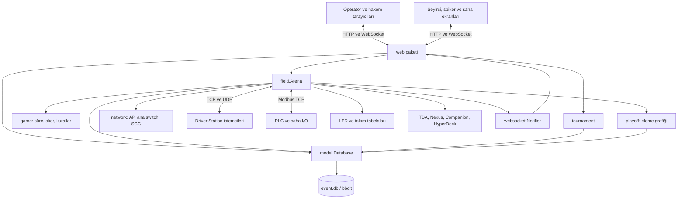
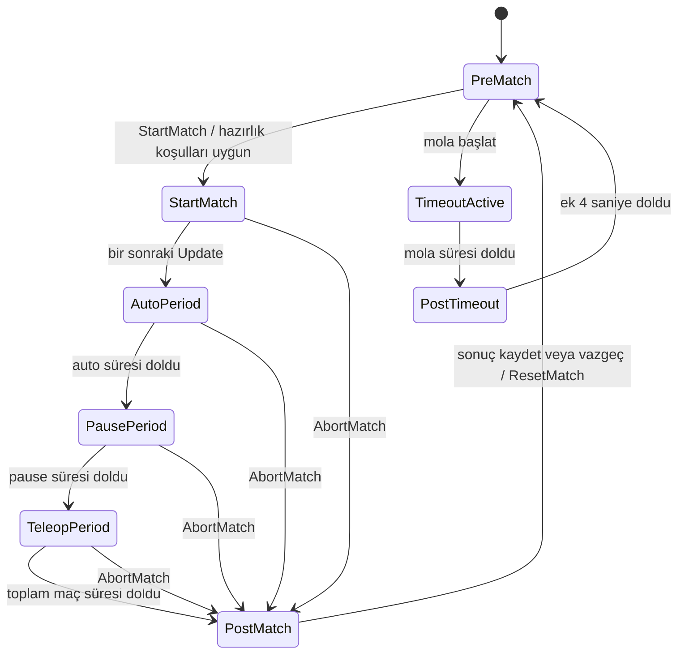
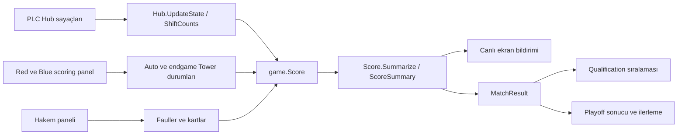
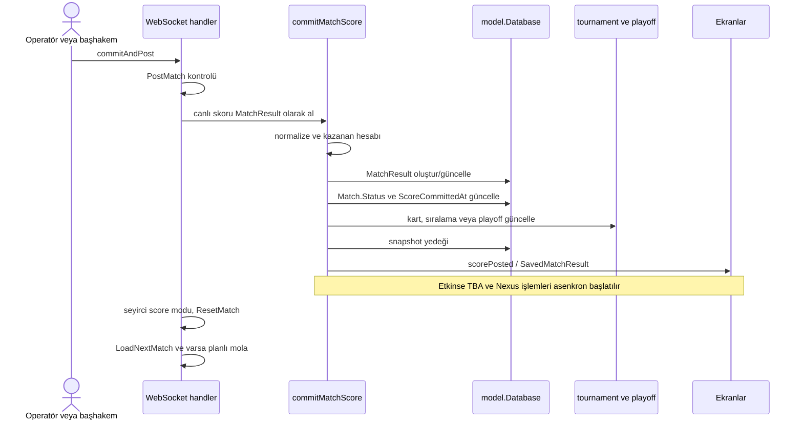
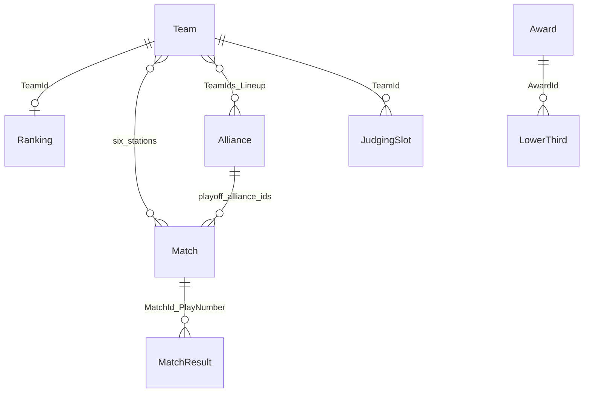

# Sheesy Arena — ayrıntılı sistem haritası

Sonraki geliştirme: [Manual FUEL Control — yeni skor katmanları, endpoint'ler, kullanım ve test raporu](manual-fuel/README.md). Aşağıdaki envanter, belirtilen temel sürümün haritasıdır.

İnceleme tarihi: **29 Ekim 2026**. Temel alınan sürüm: **a525aa290cebdcb9bc8139e51e0a098f390399f3**. Repo: **sSal1m/sheesy-arena**. Bu belge mevcut kodun haritasıdır; önerilen değişiklikler ve test bulguları ayrıca işaretlenmiştir.

Sistem; bir FRC etkinliğinde takım listesini, maç programını, robotların maç durumunu, saha giriş/çıkışlarını, canlı skoru, sonuçları, sıralamaları ve yayın ekranlarını aynı Go uygulamasında birleştirir. İncelenen oyun kodu **2026 Hub/Fuel/Tower** mantığına özeldir. Yeni repo adı henüz uygulamanın ekrandaki `Cheesy Arena` markasını veya Go modül yolunu değiştirmemiştir.

## Bu harita nasıl okunmalı?

| Belge | İçerik |
| --- | --- |
| Bu dosya | Bileşenlerin görevleri, bağlantıları, iş akışları ve değişiklik noktaları |
| [HTTP rotaları](harita/HTTP-ROTALARI.md) | 115 rota, yöntem, handler, kaynak satırı ve doğrudan erişim kontrolü |
| [WebSocket sözleşmeleri](harita/WEBSOCKET.md) | 23 uç, abonelikler, istemci komutları, yanıt türleri |
| [Veri sözlüğü](harita/VERI-SOZLUGU.md) | 21 temel yapının alanları, tipleri ve ID etiketleri |
| [Kaynak envanteri](harita/KAYNAK-ENVANTERI.md) | Her üretim Go dosyası, 664 fonksiyon, iç bağımlılıklar, şablon ve JS eşleştirmeleri |
| [Doğrulama ve bulgular](harita/DOGRULAMA-VE-BULGULAR.md) | Çalıştırılan kontroller, başarısız testler ve koddan görülen teknik sınırlar |
| [Makine tarafından okunabilir envanter](harita/envanter.json) | Aynı envanterin JSON karşılığı |

Kaynak bağlantıları repo içi göreli yollardır. `#L...` ekleri GitHub üzerinde satıra gider. Envanter, canlı etkinlik veritabanını veya kimlik bilgilerini okumadan üretilmiştir.

## 1. Sistem sınırı ve çalışma biçimi

Uygulama bir **tek süreçli, modüler Go sunucusudur**. Ayrı frontend sunucusu, npm derleme hattı, PostgreSQL, Redis veya Docker zorunluluğu yoktur. Tarayıcıya Go şablonlarından HTML; `static/` içinden CSS, JavaScript, resim ve ses dosyaları sunulur. Kalıcı etkinlik verisi tek `event.db` dosyasındadır.



**Kaynak ölçümü:** 12 Go paketi; 109 üretim Go dosyası; yorumlar ve boşluklarla 19.499 üretim Go satırı; 88 Go test dosyasında 335 üst seviye test fonksiyonu. Ayrıca 50 şablon dosyası, kütüphaneler hariç 29 JavaScript dosyası, 18 CSS dosyası ve 1.330 maç programı CSV şablonu bulunur. JavaScript sayısına mevcut bir test dosyası da dahildir.

## 2. Klasörler ve sorumluluklar

| Alan | Sorumluluk | Başlıca giriş noktası |
| --- | --- | --- |
| `main.go` | CLI bayrağı, veritabanı yolu, web portu, süreç başlangıcı | [main.go](../main.go) |
| `field/` | Arena durum makinesi, altı istasyon, DS bağlantıları, bildirimler, ekran kayıtları, saha iş akışı | [arena.go](../field/arena.go) |
| `game/` | Sezona özel skor, süreler, Hub vardiyaları, cezalar, sıralama kriterleri | [score.go](../game/score.go), [hub.go](../game/hub.go) |
| `model/` | Kalıcı kayıtlar, bbolt erişimi, JSON serileştirme ve yedekleme | [database.go](../model/database.go), [table.go](../model/table.go) |
| `tournament/` | Practice/qualification programı, jüri takvimi, sıralama, kart birikimi, ödüller | [schedule.go](../tournament/schedule.go) |
| `playoff/` | Tek/çift eleme grafiği, karşılaşmalar, kazanan/kaybeden aktarımı | [playoff_tournament.go](../playoff/playoff_tournament.go) |
| `network/` | Takım Wi-Fi yapılandırması, VLAN/DHCP, SCC port açma/kapama | [access_point.go](../network/access_point.go), [switch.go](../network/switch.go) |
| `plc/` | Modbus I/O, sağlık durumu, motor ve ışık çıkışları | [plc.go](../plc/plc.go) |
| `led/` | E1.31/sACN paketleri, LED modları, fiziksel DMX fixture eşleştirmesi | [controller.go](../led/controller.go), [fixture.go](../led/fixture.go) |
| `partner/` | TBA, Nexus, HyperDeck ve Bitfocus Companion istemcileri | İlgili `tba`, `nexus`, `blackmagic`, `companion` dosyaları |
| `web/` | HTTP handler'ları, kullanıcı girişi, WebSocket komutları, raporlar | [web.go](../web/web.go) |
| `websocket/` | JSON mesaj zarfı, bağlantı yazma kilidi, pub/sub notifier altyapısı | [websocket.go](../websocket/websocket.go), [notifier.go](../websocket/notifier.go) |
| `templates/` | HTML, CSV, SVG şablonları | [base.html](../templates/base.html) |
| `static/` | Tarayıcı kodu, stiller, fontlar, resimler, sesler; çalışma sırasında log ve avatarlar | [cheesy-websocket.js](../static/js/cheesy-websocket.js) |
| `schedules/` | Önceden hazırlanmış anonim takım eşleşmeleri | `<takım_sayısı>_<takım_başı_maç>.csv` |
| `font/` | PDF çekirdek font kaynakları | Helvetica JSON dosyaları |
| `.github/workflows/` | Linux üzerinde build, Go testleri ve biçim kontrolü | [test.yml](../.github/workflows/test.yml) |
| Yerel başlatıcılar | Windows'ta arka planda açma, tarayıcı yönlendirme ve durdurma | [Baslat.ps1](../Baslat.ps1), [Durdur.ps1](../Durdur.ps1) |

`field` ve `web` orkestrasyonun yoğun olduğu iki pakettir. `game`, ağ ve veritabanı bilmeyen hesaplama katmanıdır. Buna karşılık `web` yalnızca bir sunum katmanı değildir: sonuç kaydetme ve turnuva güncelleme zincirinin önemli bir bölümü `web/match_play.go` içindedir.

## 3. Başlangıçtan çalışan sisteme

Kaynaklar: [main.go](../main.go), [NewArena ve LoadSettings](../field/arena.go), [Arena.Run](../field/arena.go), [Windows başlatıcı](../Baslat.ps1).

1. `Baslat.cmd`, `Baslat.ps1` dosyasını çalıştırır. Çalışma dizini repo köküne alınır. Aynı exe zaten çalışıyorsa yeniden başlatılmaz; başka süreç 8080'i kullanıyorsa hata verilir.
2. Başlatıcı `cheesy-arena.exe -dev` sürecini gizli pencerede açar; stdout/stderr iki yerel loga yönlendirilir. Ana sayfanın yanıtını bekleyip tarayıcıyı açar.
3. `main`, tek CLI bayrağı olan `-dev` değerini okur. HTTP portu `8080`, veritabanı yolu `./event.db` kodda sabittir.
4. `NewArena`, notifier'ları, PLC istemcisini, `R1/R2/R3/B1/B2/B3` istasyonlarını, ekran kayıtlarını, takım tabelalarını ve LED denetleyicisini oluşturur.
5. bbolt açılır; 13 tablo kaydedilir. İlk açılışta ayarlar yoksa varsayılan `Untitled Event` kaydı oluşturulur.
6. `LoadSettings`, ağ/donanım ve dış servis istemcilerini ayarlar; oyun süreleri ve bonus eşiklerini yükler; playoff grafiğini kurup kayıtlı sonuçlarla günceller.
7. Arena `PreMatch` durumunda boş bir test maçı yükler. Seyirci ekranı başlangıçta `blank`, istasyon ekranı `match` modundadır.
8. HTTP sunucusu ayrı goroutine'de başlar. Ana goroutine `Arena.Run` döngüsüne girer.
9. DS için ortak UDP soketi önce açılır; ardından DS TCP dinleyicisi, UDP okuma, AP izleme ve PLC döngüleri başlatılır.

`-dev`, **DS dinleyicilerinin yerel IP kısıtını kaldırır**. Otomatik robot simülasyonu oluşturmaz, bağlantı/hazırlık koşullarını kaldırmaz ve web sunucusunu yalnızca localhost'a bağlamaz. Web sunucusu `:8080` üzerinde dinler. Normal saha modunda DS için `10.0.100.5` kullanılır.

### Zamanlayıcılar ve eşzamanlılık

| Mekanizma | Kodda belirlenen süre | İşlev |
| --- | --- | --- |
| Arena döngüsü | Her iterasyondan sonra 10 ms bekleme | Süre, durum geçişi, skor, PLC, LED ve tabela güncellemesi |
| Arena yavaşlık uyarısı | İşlem kısmı 5 ms'yi aşarsa | Çalışma gecikmesini loglama |
| DS kontrol gönderimi | 500 ms; ayrıca periyot geçişleri | Auto/enabled/stop durumu ve maç bilgisi |
| DS gecikme uyarısı | 550 ms | Uzayan kontrol paketi aralığı |
| Takım log örneklemesi | 500 ms | İstasyona ait bağlantı ve telemetri kaydı |
| Periyodik işler | 15 s | Etkinlik gecikmesi, kopmuş ekranların temizliği, Nexus kadro kontrolü |
| AP izleme | 1 s | Wi-Fi bağlantı ve yapılandırma durumu |
| PLC döngüsü | Hedef 100 ms | Modbus okuma/yazma |
| WebSocket uygulama ping'i | 10 s | Kopmuş istemciyi fark etme |
| Tarayıcı yeniden bağlanması | 3 s | Bağlantı koptuktan sonra yeni WebSocket |
| Field Testing LED önizlemesi | 100 ms | Tarayıcıya piksel/mod bilgisi |

Arena döngüsü işlem süresine ek olarak 10 ms uyuduğu için bu yapı kesin 100 Hz veya gerçek zamanlı işletim sistemi garantisi vermez. Notifier ve bazı kayıtlar mutex kullanır; Arena'nın bütün alanları tek bir genel kilitle korunmaz. Paylaşılan alanlar HTTP ve donanım goroutine'lerinden de değişebilir; bu durum [teknik bulgular](harita/DOGRULAMA-VE-BULGULAR.md) içinde değerlendirilmiştir.

## 4. Arena'nın bellek içi haritası

| Alan grubu | Örnek alanlar | Anlam |
| --- | --- | --- |
| Kalıcı veriye erişim | `Database`, `EventSettings` | Dosya veritabanı ve çalışma anındaki ayar kopyası |
| Aktif maç | `CurrentMatch`, `MatchState`, `MatchStartTime` | Şu anda yönetilen maç ve sayacı |
| Canlı skor | `RedRealtimeScore`, `BlueRealtimeScore` | Değişen oyun skoru, kartlar, hakem onayı, aktif Hub süresi |
| İstasyonlar | `AllianceStations` | Takım, DS bağlantısı, stop/bypass, Wi-Fi/Ethernet ve takım logu |
| Sonuç yayını tamponu | `SavedMatch`, `SavedMatchResult`, `SavedRankings` | Aktif maç değişse bile seyirciye gösterilecek son sonuç |
| Ekran yönetimi | `Displays`, `displayRevision` | Bağlı tarayıcıların kimliği, tipi, URL ayarları ve revizyonu |
| Seyirci/istasyon modları | `AudienceDisplayMode`, `AllianceStationDisplayMode` | Hangi görünümün gösterileceği |
| Turnuva seçimi | `AllianceSelectionAlliances`, `AllianceSelectionRankedTeams` | Finalize edilmemiş seçim taslağı ve seçilmiş takım işaretleri |
| Eleme grafiği | `PlayoffTournament` | Sonuçlardan yeniden oluşturulan playoff bağlantıları |
| Sunum | `LowerThird`, `ShowLowerThird`, `MuteMatchSounds` | Alt bant ve ses görünürlüğü |
| Saha işaretleri | `FieldVolunteers`, `FieldReset` | Saha ekibine ışık/tabela sinyalleri |

**Ayrılması gereken üç kavram:** `CurrentMatch` canlı operasyondur; `MatchResult` kayıtlı sonuçtur; `SavedMatchResult` yayın tamponudur. Örneğin sonraki maç yüklenirken seyirci ekranında önceki maçın sonucu gösterilebilir. Bir alanı değiştirip diğer ikisinin de değişeceğini varsaymak yanlış sonuç verir.

## 5. Maç durum makinesi

Kaynak: [field/arena.go](../field/arena.go), [match_timing.go](../game/match_timing.go).



Şema ana akışı gösterir. Yardımcı fonksiyonların kabul ettiği ek durumlar da vardır: `ResetMatch`, `TimeoutActive` sırasında molayı korur; maç yükleme `PreMatch` veya `TimeoutActive` sırasında mümkündür; mola başlatma `PreMatch` koşulu ister. Ayrıntılı koşullar ilgili fonksiyonlarda uygulanır.

### Varsayılan maç zaman çizelgesi

| Aralık | Faz | Robot kontrolü |
| --- | --- | --- |
| 0–20 s | Auto | Auto açık, robotlar etkinleştirilir |
| 20–23 s | Pause | Robotlar devre dışı |
| 23–33 s | Teleop transition | Teleop etkin; iki Hub aktif |
| 33–58 s | Shift 1 | Hub aktifliği auto kazananına bağlı |
| 58–83 s | Shift 2 | Aktif taraf değişir |
| 83–108 s | Shift 3 | Aktif taraf değişir |
| 108–133 s | Shift 4 | Aktif taraf değişir |
| 133–163 s | Endgame | İki Hub aktif; son oyun fazı |
| 163 s sonrası | PostMatch | Robotlar devre dışı, skor onayı beklenir |

Teleop = `TransitionShiftDurationSec + 4 × ShiftDurationSec + EndgameDurationSec` = **140 s**. Auto + pause + teleop toplamı **163 s**. Bunlar kodun varsayılanlarıdır; ayar ekranından değiştirilebilir. Hub sayımında ayrıca **3 s scoring grace** bulunur. Motor kapatma hesabı, normal maç bitişi veya abort sonrasına **3 + 7 = 10 s** ekler; saha E-stop'u basılıyken motorlar durur.

### Maç başlamadan kontrol edilenler

- Arena `PreMatch` olmalı; devam eden maç veya bekleyen sonuç olmamalı.
- İstasyonlarda E-stop etkin olmamalı ve önceki autonomous stop sıfırlanmış olmalı.
- Bypass edilmemiş her istasyonda DS bağlantısı ve `RobotLinked` olmalı.
- PLC etkinleştirilmişse sağlıklı olmalı; saha E-stop'u kapalı, FTA ready anahtarı açık ve ArmorBlock bağlantıları sağlam olmalı.

Bypass, bağlantı koşulunu aşar fakat o istasyonun robotunu etkinleştirmez. `sendDsPacket`, E-stop, auto sırasında A-stop ve bypass için `Enabled` değerini ayrıca kapatır. Bu nedenle bypass'ı sanal robot oluşturma işlevi gibi değerlendirmemek gerekir.

### Maç yükleme, bitirme ve sonraki maça geçiş

`LoadMatch`, takımları altı istasyona yerleştirir, skor/kart durumunu hazırlar, gerekiyorsa Nexus kadrosunu alır, ağ yapılandırmasını başlatır ve istemcilere bildirim gönderir. Takım değişikliği qualification maçlarında engellenir; Nexus kadro değişikliği Practice ve Playoff için uygulanabilir.

Normal bitişte robotlar kapatılır; seyirci skoru 3 s sonra boşaltılabilir, sonraki maçın ağı 5 s sonra önceden hazırlanır. HyperDeck kaydı gecikmeli durdurulur. **Maçın bitmesi sonuç kaydı anlamına gelmez**: sonuç `PostMatch` sırasında ayrı komutla kaydedilir.

`AbortMatch`, maçı `PostMatch` durumuna alır; abort sesi ve yayın otomasyonu çalışır. Mola abort'u ise sayacı mola sonuna ilerletir. `ResetMatch`, takım loglarını kapatır, bypass'ları ve ses susturma durumunu sıfırlar.

## 6. Skor, Hub ve sıralama kuralları

Kaynaklar: [score.go](../game/score.go), [hub.go](../game/hub.go), [foul.go](../game/foul.go), [score_summary.go](../game/score_summary.go), [ranking_fields.go](../game/ranking_fields.go).

### Skorun girdileri



| Bileşen | Kodda uygulanan kural |
| --- | --- |
| Auto Fuel | Aktif auto sayımı başına 1 puan |
| Auto Tower | Tower seviyelerinden herhangi birine ulaşan robot için 15; en fazla iki robot sayılır |
| Teleop Fuel | Aktif Hub vardiyalarındaki sayım başına 1 puan; grace/postmatch sayımı ayrıca takip edilir |
| Teleop Tower | Level1=10, Level2=20, Level3=30 |
| Minor foul | Rakibe 5 puan; özel G206 işareti minor olarak 0 puan |
| Major foul | Rakibe 15 puan |
| Playoff DQ | Diskalifiye ittifak özeti sıfırlanır |
| Energized RP | Varsayılan Fuel eşiği 100 |
| Supercharged RP | Varsayılan Fuel eşiği 360 |
| Traversal RP | Varsayılan auto+teleop Tower puanı eşiği 50; eşik 0 olursa bonus devre dışı |
| G206 | İttifakın üç bonus RP hakkını kaldırır |

Faul listesi faulü yapan ittifakta tutulur; `Summarize`, **rakibin** faullerini kendi puanına ekler. `PostMatchPoints`, endgame Tower puanları ve postmatch Fuel bilgisini ayrı verir; canlı ekran toplamdan bu kısmı çıkararak maç sonrası puanları henüz göstermeyebilir. Bu ayrım [display_shared.js](../static/js/display_shared.js) içinde görünür.

Hub, `ShiftAuto`, `ShiftTransition`, `Shift1..4`, `ShiftEndgame`, `ShiftPostMatch` sayımlarını tutar. Donanımın kümülatif sayacı ile daha önce kaydedilen toplam arasındaki pozitif fark mevcut vardiyaya eklenir. Auto sonucunda yalnızca auto Fuel karşılaştırılır; eşitlikte taraf rastgele seçilir. Kazananın Hub'ı Shift2/4, diğerinin Shift1/3 sırasında aktiftir. Sonuç `R` veya `B` oyun verisi olarak DS'lere iletilir.

### Qualification sıralaması

`tournament.CalculateRankings`, tamamlanmış qualification maçlarının en güncel sonuçlarını yeniden dolaşır. Surrogate katılımlar takımın sıralamasına eklenmez. Takım bazlı red/dq kartı o maç için sıralama puanını engeller.

Sıralama önceliği, maç başına ortalamalar üzerinden şöyledir:

1. Ranking Points.
2. Match Points.
3. Auto Fuel Points.
4. Tower Points.
5. Rastgele bağ kırıcı.

Karşılaştırmada bölme yerine çapraz çarpım kullanılır. Kazanma RP'si normalde 3; Traversal bonusu kapalıysa 2'dir. Beraberlik 1 RP verir; bonuslar buna eklenir. `PreviousRank`, ekranda sıralama değişimini göstermek için saklanır.

### Playoff beraberlik sırası

Önce DQ ve toplam skor değerlendirilir. Maçta `UseTiebreakCriteria` açıksa eşitlikler sırasıyla rakibin major foul sayısı, auto Fuel, toplam Tower puanı ile çözülür; hâlâ eşitse `TRUE TIE` döner. Bu koşul her playoff maçı için otomatik açık varsayılmamalıdır; bracket maç tanımı tarafından belirlenir.

## 7. Sonuç kaydetme ve yayınlama zinciri

Kaynak: [web/match_play.go](../web/match_play.go), [web/match_review.go](../web/match_review.go).



`commitPostAndLoadNextMatch`, yalnızca `PostMatch` durumunda çalışır. Yeni oynanış için önceki sonucun `PlayNumber` değeri artırılır; eski kayıt düzenleniyorsa mevcut sonuç güncellenir. `GetMatchResultForMatch` en yüksek `PlayNumber` değerini seçer. Test maçları bu kalıcı maç/sonuç zincirine yazılmaz.

Qualification sonuçları kartları ve sıralamayı yeniden hesaplatır. Playoff sonuçları ittifak kadrosunu, kartlarını ve sonraki maçları günceller; turnuva tamamlandıysa kazanan/finalist ödülleri üretilir. TBA yayını etkinse maçlar ve gerektiğinde sıralamalar gönderilir. Nexus AutoQueue, sonuç incelemesi dışındaki kayıtlarda tetiklenir.

Hakem `commitAndPost` komutu her iki ittifakın `FoulsCommitted` işaretini de koyar. Scoring panelindeki `commitMatch` ise o panelin onayını kaydeder; tek başına sonucu veritabanına yazmaz. Panel onayları durum/ışık göstergelerine katılır; ana sonuç kaydetme fonksiyonunun kontrolü tüm panellerin onayını zorunlu kılan genel bir kapı değildir.

Sonuç incelemesi aktif maça uygulanıyorsa bellek içi skor güncellenir. Geçmiş maça uygulanıyorsa aynı kaydetme zinciri `isMatchReviewEdit=true` ile çalışır. Bu durumda sıralama değişim referansı korunur ve normal maç sonu yayın tamponu/AutoQueue akışı aynı şekilde tetiklenmez.

Önemli işlem sınırı: sonuç, maç, kartlar ve sıralama için ayrı bbolt işlemleri vardır; tüm iş zinciri tek atomik transaction değildir. Bir ara adımda hata oluşması önceki başarılı kayıtları otomatik geri almaz.

## 8. Kalıcı veri modeli

Kaynak: [database.go](../model/database.go), [table.go](../model/table.go). Aktif dosya **repo kökündeki `event.db`**; `db/backups/` yedek klasörüdür. Bu ayrım AGENTS.md içindeki genel `db/` ifadesinden daha kesin biçimde çalışma kodunda görülür.

| Bolt bucket | Anahtar | Kayıt görevi |
| --- | --- | --- |
| `EventSettings` | Otomatik ID | Etkinlik, oyun, ağ, donanım, giriş ve dış servis ayarları |
| `Team` | Takım numarası, manuel | Kimlik, konum, robot adı, WPA, kart, bağlantı geçmişi ve FTA notları |
| `Match` | Otomatik ID | Tür/sıra/zaman, altı takım, surrogate, durum, playoff ve TBA eşleşmesi |
| `MatchResult` | Otomatik ID | MatchId, PlayNumber, iki skor, takım/ittifak kartları |
| `Ranking` | TeamId, manuel | Güncel/önceki sıra ve birikmiş sıralama alanları |
| `Alliance` | İttifak numarası, manuel | Seçilen takımlar, üçlü aktif kadro, taşınan sarı kart |
| `ScheduleBlock` | Otomatik ID | Maç üretim zaman blokları |
| `ScheduledBreak` | Otomatik ID | Belirli maçtan önceki mola, zaman ve süre |
| `JudgingSlot` | Otomatik ID | Takımın jüri görüşmesi zaman dilimi |
| `Award` | Otomatik ID | Ödül adı, kazanan takım/kişi, varsa TBA ödül türü |
| `LowerThird` | Otomatik ID | Alt/üst metin, ödül bağlantısı, gösterim sırası |
| `SponsorSlide` | Otomatik ID | Görsel, metinler, süre ve sıra |
| `UserSession` | Otomatik ID | UUID token, kullanıcı adı ve oluşturulma zamanı |



Şema **mantıksal ilişkileri** gösterir. bbolt ilişkisel veritabanı olmadığı için SQL foreign key, join veya şemadan gelen ilişki zorlaması yoktur. Oturum ve ayar kayıtları bağımsız bucket'lardadır; aralarında bir foreign key bulunmaz.

### Tablo erişimi

`table[R]`, yapı adından bucket adını çıkarır. `db:"id"` etiketli alanı reflection ile bulur; otomatik ID için bbolt sequence kullanılır. Anahtar, tamsayının ondalık metnidir; kayıt JSON'dur. Genel `getAll` sırası ID'nin metinsel sırasıdır; sayısal veya iş sırası isteyen model metotları ayrıca sıralar.

Kayıtlar eklenirken/güncellenirken tek kayıt düzeyinde bbolt transaction kullanılır. Birçok arama `getAll` sonrasında bellek içinde filtrelenir; örneğin bir maçın en güncel sonucunu bulma tüm sonuçları tarar. Uygulama ölçeği etkinlik odaklıdır; büyük veri ve çok kiracılı kullanım için ayrı bir veri erişim tasarımı yoktur.

`bbolt.Open`, `NoSync:true` ve 1 s dosya kilidi bekleme süresi ile açılır. Bu yapı hız lehine disk senkronizasyonunu gevşetir. Ani kapanma dayanıklılığı, düzenli snapshot yedekleriyle birlikte değerlendirilmelidir.

### Kalıcı olmayan durum

Aktif maçın zamanlayıcısı, canlı skor, yayın tamponu, bağlı ekran kayıtları, finalize edilmemiş ittifak seçimi ve üretilip kaydedilmemiş program önizlemesi süreç belleğindedir. Süreç yeniden başlatıldığında maçın kaldığı saniyeden devam edilmez; boş test maçıyla başlanır. Kalıcı playoff kayıtlarından eleme grafiği yeniden oluşturulur.

## 9. Etkinlik hazırlığı ve turnuva ilerleyişi

### Takımlar ve ayarlar

`/setup/settings` ekranında etkinlik/oyun/saha/yayın/otomasyon ayarları bulunur. Süre ve bonus alanları `LoadSettings` üzerinden oyun paketine aktarılır. Ayar kaydı yalnızca `PreMatch`, `TimeoutActive`, `PostTimeout` sırasında kabul edilir. Parola değiştiğinde kayıtlı kullanıcı oturumları silinir.

`/setup/teams` takım numaralarından takım kaydı üretir. `TbaDownloadEnabled` varsayılan olarak açıktır; resmi bilgiler, robot adı, geçmiş başarılar ve avatarlar TBA'dan alınabilir. İnternetsiz etkinlik için bu ayarın davranışı dikkate alınmalıdır. WPA üretim uzunluğu 8 karakterdir; elle verilen WPA anahtarı 8–63 karakter doğrulamasından geçer. Takım düzenleme, yenileme ve liste değişikliği kontrolleri [setup_teams.go](../web/setup_teams.go) içindedir.

### Practice ve qualification programı

1. En az 6 takım seçilir; zaman blokları ve maç aralıkları girilir.
2. `BuildRandomSchedule`, toplam kapasiteden takım başına maç sayısını hesaplar.
3. `schedules/<N>_<M>.csv` anonim eşleşme dosyası açılır; yoksa program üretilemez.
4. Takımların sırası rastgele permütasyonla şablondaki yerlere atanır. CSV her istasyon için takım ve surrogate işaretini taşır.
5. Saatler bloklara göre doldurulur. Üretilen maçlar önce `cachedMatches` içinde önizlenir.
6. Kaydetme eylemi maçları kalıcı hale getirir. Zaman blokları üretim isteğinde daha önce kaydedilmiş olabilir.

Buradaki rastgeleleştirme sıfırdan eşleşme optimizasyonu değildir; hazırlanmış anonim programın gerçek takımlarla eşleştirilmesidir.

### Jüri takvimi

`BuildJudgingSchedule`, qualification programı ve bloklarından yararlanır. Paralel jüri grubu sayısı, görüşme süresi ve maçtan önce/sonra bırakılacak tampon süreler parametredir. Var olan jüri slotları varken yeniden üretim engellenir. Takımlar rastgele karıştırılır; uygun zamanlar atanır. Çıktı `JudgingSlot` kayıtları ve PDF raporudur.

### İttifak seçimi

Sıralama listesinden kaptanlar ve seçilebilir takımlar hazırlanır. İttifak başına normalde 3 takım, üçüncü seçim turu etkinse 4 takım yer alabilir. Aynı takımın iki kez seçilmesi engellenir. Seçim taslağı bellekte tutulur; finalize edilince ittifaklar yazılır ve playoff maçları/molaları oluşturulur. Varsayılan seçim sayacı 45 s; turlar arası mola 120 s'dir. Sayaç için başlat/durdur/yeniden başlat/gizle komutları vardır.

### Playoff motoru

`MatchGroup`, grafikteki aşamanın arayüzüdür. `Matchup` bir seriyi, `allianceSelectionSource` başlangıç seed'ini, `matchupSource` önceki karşılaşmanın kazananını veya kaybedenini temsil eder. `matchSpec` fiziksel maçın adını, sırasını, süresini ve bağ kırıcı ayarını tanımlar.

- **Double elimination:** tam olarak 4 veya 8 ittifak; final 2 galibiyet gerektirir.
- **Single elimination:** 2–16 ittifak; best-of-three yapısı, gerekli olmayan eşleşmelerin ayıklanması.
- Sonuçlar grafikte kazanan/kaybeden kaynaklarına aktarılır; sonraki kadrolar güncellenir.
- Gizli veya koşullu maçlar `MatchHidden` durumuyla tutulabilir; kullanıcı listeleri bunları filtreler.
- Maçlar arasında planlı ödül/saha molaları oluşturulur.
- Tamamlanan finalden kazanan/finalist ittifakları ve ödülleri çıkarılır.

### Ödüller, sponsorlar ve alt bantlar

`CreateOrUpdateAward`, ödülü doğrular ve ilişkili tanıtım/kazanan alt bantlarını oluşturur veya günceller. Ödül silme ilişkili alt bantları da temizler. Playoff tamamlanınca kazanan/finalist ödülleri bu mekanizmayı kullanır. Sponsor slaytlarında görsel, üç metin alanı, gösterim süresi ve sıra vardır. Alt bant kaydı kalıcıdır; o anda gösterilip gösterilmediği Arena belleğindedir.

## 10. Kullanıcı ekranları ve frontend akışı

Frontend; Go `text/template`, jQuery ve yerel Bootstrap dosyalarıyla çalışır. React/Vue veya paket yöneticisi zorunluluğu yoktur. `base.html`, navbar ve ortak dosyaları sağlar; scoring/referee panelleri navbar içermeyen taban şablonu kullanabilir.

| Kullanıcı işi | Sayfa | İlgili kod |
| --- | --- | --- |
| Etkinlik, oyun, donanım ve yayın ayarları | `/setup/settings` | `web/setup_settings.go`, `templates/setup_settings.html` |
| Takımlar | `/setup/teams` | `web/setup_teams.go` |
| Maç programı | `/setup/schedule` | `web/setup_schedule.go`, `static/js/setup_schedule.js` |
| Jüri programı | `/setup/judging` | `web/setup_judging.go` |
| Ödüller | `/setup/awards` | `web/setup_awards.go` |
| Sponsor/alt bant/mola | `/setup/sponsor_slides`, `/setup/lower_thirds`, `/setup/breaks` | İlgili setup handler'ları |
| Ekran yönetimi | `/setup/displays` | `web/setup_displays.go`, `static/js/setup_displays.js` |
| Donanım testi | `/setup/field_testing` | `web/setup_field_testing.go` |
| Maç yükleme, başlatma, durdurma ve yayınlama | `/match_play` | `web/match_play.go`, `static/js/match_play.js` |
| Sonuç inceleme/düzeltme | `/match_review` | `web/match_review.go`, `static/js/match_review.js` |
| DS/istasyon logları | `/match_logs` | `web/match_logs.go` |
| İttifak seçimi | `/alliance_selection` | `web/alliance_selection.go`, `static/js/alliance_selection.js` |
| Kırmızı/mavi puan girişi | `/panels/scoring/red`, `/panels/scoring/blue` | `web/scoring_panel.go` |
| Hakem | `/panels/referee` | `web/referee_panel.go` |

### Uzak gösterim ekranları

| Ekran | Yol | İçerik |
| --- | --- | --- |
| Placeholder | `/display` | Uzaktan tipi atanacak boş ekran |
| Alliance Station | `/displays/alliance_station` | İstasyon, saat veya skor görünümü; `station` parametresi |
| Audience | `/displays/audience` | Maç tanıtımı, canlı maç, sonuç, bracket, sponsor, seçim ve ses |
| Announcer | `/displays/announcer` | Spiker için takım/maç/sonuç ve etkinlik durumu |
| Bracket | `/displays/bracket` | SVG eleme ağacı |
| Field Monitor | `/displays/field_monitor` | DS, radio, robot ve saha bağlantıları |
| FMS Field Monitor | `/displays/fms_field_monitor` | Aynı izleme akışının farklı görünümü |
| Logo | `/displays/logo` | Etkinlik/logo gösterimi |
| Queueing | `/displays/queueing` | Takım çağrı ve gelecek maç bilgisi |
| Rankings | `/displays/rankings` | Qualification sıralamaları |
| Unpicked | `/displays/unpicked` | İttifak seçiminde seçilmemiş takımlar |
| Wall | `/displays/wall` | Canlı maç/skor duvar görünümü |
| Webpage | `/displays/webpage` | Yapılandırılmış web sayfası |
| Twitch | `/displays/twitch` | Harici Twitch oynatıcısı |
| YouTube | `/displays/youtube` | Harici YouTube oynatıcısı |

Tarayıcı `CheesyWebsocket` ile aynı host/port'a bağlanır; HTTPS varsa WSS, aksi halde WS seçilir. Sayfanın query parametreleri bağlantıya taşınır. Bağlantı kopunca 3 s sonra yeniden bağlanır. İlk abonelikte güncel durumların gönderilmesi istemcinin ekranını yeniden kurmasını sağlar.

`displayId` yoksa sunucu ID ve varsayılan parametrelerle URL'yi tamamlayıp yönlendirir. Ekran WebSocket bağlantısı sırasında Arena kayıt defterine girer; IP, bağlantı sayısı, son bağlantı zamanı tutulur. Yapılandırma URL üzerinden taşınır; ekran kayıtları ayrı bir Bolt tablosunda saklanmaz. Kopuk kayıtlar 30 dakika eşiğine göre temizlenir.

`configureDisplay`, ekranın URL'sini değiştirir. Yeni yönetim akışında `RequestId`, `Revision` ve `displayConfigurationSaved` mesajı eski snapshot ile kaydetme yanıtının karıştırılmasını önlemeye yardımcı olur. `reloadDisplay` yalnızca seçilen ekranı, `reloadAllDisplays` tüm uygun aboneleri yeniler.

Seyirci modları: `blank`, `intro`, `match`, `score`, `bracket`, `logo`, `logoLuma`, `sponsor`, `allianceSelection`, `timeout`. İstasyon ve seyirci modu birbirinden bağımsızdır. `AutoAudienceDisplayEnabled`, sonuç sonrası bazı geçişleri otomatikleştirir. Ses dosyaları sunucu hoparlöründe doğrudan çalınmaz; `playSound` mesajını alan tarayıcı tarafından `static/audio/` içinden oynatılır. Tarayıcı ses/otomatik oynatma davranışı saha kurulumunda önemlidir.

## 11. HTTP ve WebSocket sözleşmesi

Tam liste [HTTP-ROTALARI.md](harita/HTTP-ROTALARI.md) ve [WEBSOCKET.md](harita/WEBSOCKET.md) içindedir. HTTP salt okunur JSON API şu temel uçları sunar:

| Uç | Veri |
| --- | --- |
| `/api/matches/{type}` | `practice`, `qualification`, `playoff` maçları, en güncel sonuç ve skor özetleri |
| `/api/rankings` | Takım nickname'iyle sıralama ve son oynanan qualification maçı |
| `/api/alliances` | Playoff ittifakları |
| `/api/sponsor_slides` | Sponsor slayt listesi |
| `/api/teams/{teamId}/avatar` | Takım avatarı veya varsayılan görsel |
| `/api/bracket/svg` | Bracket SVG; `activeMatch=current/saved` desteklenir |
| `/api/arena/websocket` | `matchTiming`, `matchLoad`, `matchTime` olayları |

JSON uçlarının bir kısmı `Access-Control-Allow-Origin: *` gönderir. Bu, yazma işlemlerinin genel bir REST API ile yapıldığı anlamına gelmez; ana operasyon komutları sayfa WebSocket'lerindedir. Maç yükleme listeleri ve bazı ekran alt bölümleri HTTP üzerinden HTML parçası olarak da alınır.

Mesaj zarfı:

```json
{"type":"startMatch","data":{"MuteMatchSounds":false}}
```

| Olay | Taşıdığı temel bilgi |
| --- | --- |
| `matchTiming` | Faz süreleri |
| `matchLoad` | Maç, istasyon takımları, replay/ittifak/kart/ara bilgileri |
| `matchTime` | `MatchState`, tamsayı `MatchTimeSec` |
| `arenaStatus` | İstasyonlar, başlayabilme koşulları, ağ/PLC/SCC durumları |
| `realtimeScore` | İki ittifakın ham skoru, hesaplanmış özeti, aktif Hub süresi |
| `scorePosted` | Yayın tamponundaki maç, sonuç, sıralama ve ilgili bilgiler |
| `scoringStatus` | Panel sayıları ve onaylar, faul onay durumu |
| `eventStatus` | Maç çevrim süresi, programın erken/geç ilerlemesi |
| `allianceSelection` | Seçim ittifakları, kalan takımlar ve sayaç |
| `displayConfiguration` | Bağlama göre ekran yapılandırma URL'si veya yönetim snapshot'ı |
| `lowerThird` | Alt bant içeriği ve görünürlük |
| `reload`, `playSound` | Tek seferlik ekran/ses olayı |
| `plcIoChange`, `ledStatus` | Field Testing I/O ve LED önizleme |
| `ping`, `error` | Altyapı canlılık ve hata mesajları |

Her notifier abonesinde **5 mesajlık tampon** vardır. Gönderim bloklamaz; yavaş istemci için mesaj düşebilir ve log yazılır. Farklı notifier kanallarından gelen olaylar arasında toplam sıra garantisi bulunmaz. İstemcinin yeniden bağlandığında snapshot alması bu yüzden önemlidir; altyapı kalıcı mesaj kuyruğu veya olay geçmişi sağlamaz.

## 12. Robot ve saha ağı

| Bağlantı | Yön | Protokol/port | Kaynak |
| --- | --- | --- | --- |
| Web arayüzü | Tarayıcı → sunucu | HTTP/WS TCP 8080 | `main.go`, `web/web.go` |
| DS ilk bağlantı | DS → sunucu | TCP 1750 | `field/driver_station_connection.go` |
| DS telemetri | DS → sunucu | UDP 1160 | Aynı dosya |
| DS kontrol | Sunucu → DS | UDP 1121; Lite için 1120; yeni DS anlaşmasında bildirilen port | Aynı dosya |
| AP | Sunucu → VH-113/OpenWRT | HTTP; adres ayarından | `network/access_point.go` |
| Ana switch | Sunucu → Cisco | Telnet TCP 23 | `network/switch.go` |
| SCC switch | Sunucu → kırmızı/mavi SCC | SSH TCP 22 | `network/sccswitch.go` |
| PLC | Sunucu → PLC | Modbus TCP 502 | `plc/plc.go` |
| Takım tabelası | Sunucu → tabela | UDP 10011 | `field/team_sign.go` |
| LED | Sunucu → LED denetleyici | sACN/E1.31 UDP 5568 | `led/controller.go` |
| HyperDeck | Sunucu → cihaz | TCP 9993 | `partner/blackmagic.go` |
| Companion | Sunucu → Companion | TCP, ayarlanabilir port | `partner/companion.go` |
| TBA/Nexus | Sunucu → dış servis | HTTPS | `partner/` |

### Driver Station bağlantısı

Eski NI DS ve yeni DS ilk bağlantı etiketleri ayrı ele alınır. Gelen takım, mevcut veya izin verilen istasyona eşlenir; yanlış istasyon ve geçersiz takım durumları raporlanır. DS nesnesi link, voltaj, paket kaybı, round-trip zamanı, reported enabled/auto/teleop durumu ve yanlış istasyon bilgisini taşır. TCP bağlantı zaman aşımı 5 s, UDP link zaman aşımı 1 s'dir.

Takım ağ adresi `10.TE.AM.X` biçiminden çıkarılabilir. Normal FMS adresi `10.0.100.5`'tir. `UseLiteUdpPort`, eski DS için kontrol portu seçimini etkiler. Ortak UDP soketi hem alım hem kontrol paketi gönderiminde kullanılır; yeni DS'nin bildirdiği hedef port ayrıca saklanır.

### Takım ağı yapılandırması

`NetworkSecurityEnabled` açıksa her maçta altı takım için SSID/WPA ve kablolu VLAN yapılandırması hazırlanır. AP uygulaması güncel kodda **VH-113 HTTP API** kullanır: `/configuration` ve `/status`. README'nin genel SSH/Telnet anlatımı bütün cihazlar için güncel protokolü tek başına açıklamaz.

Ana switch VLAN'ları `R1=10`, `R2=20`, `R3=30`, `B1=40`, `B2=50`, `B3=60` olarak eşler. Takım ağı `10.<Id/100>.<Id%100>.0/24`, gateway son okteti `4` olacak şekilde oluşturulur; DHCP dışlama aralıkları uygulanır. SCC yönetimi açıksa takım Ethernet portları switch değişikliği sırasında kapatılıp sonra açılabilir. SCC komut dizileri ayarlardan değiştirilebilir.

Ön yükleme, sıradaki maçın ağı için bitişten sonra hazırlanır. Gerçek `LoadMatch` sırasında önceden hazırlanan takımlar aynıysa yeniden yapılandırma atlanır. AP izleme, ACTIVE yapılandırmanın beklenen takımlarla uyuşmadığını görürse yeniden deneme yapar.

## 13. PLC, LED ve tabela haritası

### PLC I/O

`Plc` arayüzü, gerçek `ModbusPlc` ve testlerdeki sahte uygulamayı ayırır. Adres boşsa fiziksel PLC bağlantısı devre dışıdır. Bağlantı hatasında 3 s sonra tekrar denenir. Modbus handler zaman aşımı 1 s; SlaveId `0xFF`'tir.

| Tür | Sıfır tabanlı kod indeksleri | İçerik |
| --- | --- | --- |
| Discrete input | 0 | Saha E-stop |
| Discrete input | 1–12 | R1,R2,R3,B1,B2,B3 için E-stop/A-stop çiftleri |
| Discrete input | 13–18 | Altı istasyonun fiziksel Ethernet bağlantısı |
| Discrete input | 19 | FTA ready |
| Discrete input | 20–27 | Kırmızı/mavi Hub için dörder sensör |
| Register | 0 | ArmorBlock bağlantı bit maskesi |
| Register | 1–2 | Kırmızı/mavi toplam Hub sayacı |
| Register | 3–6 ve 7–10 | Kırmızı/mavi tekil Hub sensör sayaçları |
| Coil | 0–1 | Heartbeat ve match reset |
| Coil | 2–6 | Stack light yeşil/turuncu/kırmızı/mavi ve buzzer |
| Coil | 7–8 | Field reset ve awards mode ışıkları |
| Coil | 9–10 | Kırmızı/mavi Hub motorları |
| Coil | 11–12 | Kırmızı/mavi Hub ışıkları |

Bunlar uygulamanın Modbus başlangıç adresi 0 ile kullandığı indekslerdir; cihaz dokümanındaki 1 tabanlı veya 4xxxx adres gösterimiyle birebir aynı yazım varsayılmamalıdır. Fiziksel PLC programı bu repoda bulunmaz.

Arena, PLC'den stop ve bağlantı durumlarını alır; Hub sayaçlarını skor katmanına geçirir; stack light, saha reset, motor ve Hub ışıklarını hesaplar. E-stop maç boyunca kilitli tutulur; A-stop auto sonuna kadar kilitlenir. `Field Testing`, giriş/register/coil adlarını gösterir ve izin verilen maç dışı durumlarda coil override/LED modu değişikliği yapar.

### LED

LED denetleyicisi E1.31 sACN paketleri üretir. Her ittifakta 64 RGB piksel; 8'er pikselli 8 fixture bulunur. Tek evren modunda iki taraf Universe1 içinde; iki evren modunda mavi Universe2'ye taşınır. Fiziksel yerleşim ve DMX başlangıç adresleri [fixture.go](../led/fixture.go) içinde sabittir. Görsel modlar [mode.go](../led/mode.go), maç durumuna göre mod seçimi [arena_leds.go](../field/arena_leds.go) içindedir.

### Cypress takım tabelaları

Altı istasyon tabelası ve kırmızı/mavi sayaç tabelaları ayarlanabilir ID'lere sahiptir. Adres `10.0.100.<ID>`, port UDP 10011, sezon alanı 2026'dır. Takım numarası, sayaç, bağlantı/kart/stop ve gönüllü/reset bilgileri paketlenir. Fiziksel tabela, webdeki Alliance Station ekranından ayrı bir donanım yoludur.

## 14. Dış servisler ve yayın otomasyonu

| Servis | Girdi / çıktı | Etkinleştirme ve tetikler |
| --- | --- | --- |
| The Blue Alliance | Takım/robot/ödül/avatar okuma; takım, maç, sıralama, ittifak, ödül yayınlama | İndirme/yayın bayrakları, etkinlik kodu, trusted API kimliği ve secret |
| Nexus | Practice/Playoff kadrosu okuma; maç başlatma, sonuç, mola başlangıç/bitiş AutoQueue olayları | Nexus bayrakları, etkinlik kodu ve AutoQueue anahtarı |
| Blackmagic HyperDeck | `record` ve `stop` TCP komutları | Virgülle ayrılmış cihaz adresleri; maç start/end/abort |
| Bitfocus Companion | `LOCATION page/row/column PRESS` | Adres, port ve her olay için buton koordinatları |
| Twitch/YouTube | Tarayıcı içi yayın oynatımı | Ekran URL yapılandırması; dış oynatıcı API'si |

Companion olayları: match preview, overlay göster, match start, teleop start, endgame start, match end, final score, alliance selection, match abort. İlgili event için page 0 ise tetik gönderilmez. HyperDeck stop komutundan önce 10 s beklenir; bağlantı denemesi zaman aşımı 100 ms'dir.

TBA trusted API gönderimleri imzalanır. Başarılı üretim TBA yayını sonrasında `cheesyarena.com/events/...` adresine kullanım pingi gönderme yolu da bulunur. Bu bir kod gözlemidir; bu incelemede etkinlik yayını yapılmamıştır. TBA HTTP istemcilerinde açık genel timeout tanımlı değildir; Nexus'ta 30 s, AP'de 3 s görülür. Dış bağlantıların gecikme davranışları aynı değildir.

Birçok entegrasyon goroutine içinde çalışır ve hatası loglanır. Tüm dış sistemlerin onay verdiği dağıtık bir transaction veya kalıcı retry kuyruğu yoktur. Kadro indirme gibi bazı işlemler ise ilgili maç yükleme akışında beklenebilir.

## 15. Raporlar, loglar, yedek ve geri yükleme

**CSV:** takımlar, FTA, program, sıralama, backup takımlar ve WPA anahtarları. Bazı CSV handler'ları dosya indirmeye zorlamamak için `text/plain` kullanır; CR karakterleri temizlenir.

**PDF:** takımlar, program, jüri takvimi, sıralama, ittifaklar, bracket, backup takımlar, kuponlar ve maç çevrim raporları. `gofpdf` kullanılır; kurulu Arial fontu bulunursa UTF-8 font kaydı yapılır, bulunamazsa çekirdek fontlara dönülür. Bracket çizimi SVG şablonundan da üretilir.

**Takım logları:** `static/logs/<zaman>_<tür>_Match_<ad>_<takım>.csv`. İstasyon sahipliğinde tutulur; DS kopsa bile kesinti satırı yazılabilir. Zaman, takım/istasyon, DS/radio/rio/robot link, auto/enabled/stop, voltaj, paket kaybı, gecikme, Wi-Fi hızı/SNR, Ethernet ve DS'nin bildirdiği durum alanları kaydedilir. Log görüntüleme yolu `/match_logs/{matchId}/{stationId}/log`'dur.

**Veritabanı yedeği:** bbolt read transaction içinde `Tx.WriteTo` snapshot'ı alınır. Dosya adı `db/backups/<event>_<timestamp>_<reason>.db` biçimindedir. Sonuç kaydı, restore/clear öncesi gibi iş adımlarında yedekleme yolları bulunur. Bu klasörün olması otomatik periyodik dış disk yedeği bulunduğu anlamına gelmez.

**İndirme:** `/setup/db/save` tutarlı snapshot'ı HTTP yanıtına yazar. Çalışan bbolt dosyasını rastgele kopyalamak yerine bu yol veya uygulama durdurulduktan sonra kopyalama kullanılabilir.

**Restore:** yüklenen dosya aynı dizindeki geçici dosyaya yazılır, veritabanı olarak açılabildiği kontrol edilir, mevcut verinin yedeği alınır, veritabanı kapatılır ve dosya değiştirilir, ardından ayarlar yeniden yüklenir. Bu işlem tüm bellek içi Arena durumunun baştan yaratılmasıyla aynı değildir. `clear/{type}` ise seçilen turnuva aşaması ve sonraki verileri temizleme işidir.

## 16. Giriş ve erişim sınırları

Kaynaklar: [login.go](../web/login.go), [user_session.go](../model/user_session.go), [tam rota tablosu](harita/HTTP-ROTALARI.md).

- Tek yönetici kullanıcı adı `admin`'dir. Ayrı hakem/scorer/FTA kullanıcı ve yetki modeli bulunmaz.
- `AdminPassword` boşsa `userIsAdmin` her isteğe izin verir. İlk kurulumun açık olması bu varsayılandan gelir.
- Girişte UUID oturumu oluşturulur ve `session_token` cookie'si verilir; oturum `UserSession` bucket'ında tutulur.
- Ayar parolası değiştiğinde mevcut oturumlar silinir. Oturum kaydındaki `CreatedAt` için okuma yolunda süre sonu kontrolü görülmez.
- Erişim kontrolü merkezi middleware yerine handler'larda çağrılır. Field Monitor'da `fta=true` koşullu kontrol vardır; normal izleme görünümü aynı kontrolü istemez.
- `?hr=false`, hakem arayüzü varyantıdır; ayrı hesap/rol ayrımı olarak değerlendirilmemelidir.

Bu haritalama sırasında özellikle iki veri sınırı görülmüştür: bazı public WebSocket mesajları doğrudan `Team` yapısını taşır; bu yapı WPA anahtarı ve FTA notlarını da içerir. Ayrıca web şablonları `html/template` yerine `text/template` kullanır. Ayrıntı ve önerilen öncelikler [bulgular belgesinde](harita/DOGRULAMA-VE-BULGULAR.md) yer alır. Bunlar internet erişimi veya gerçek sır değerleri üzerinde saldırı denenerek doğrulanmış bulgular değildir; kaynak akışı üzerinden değerlendirilmiştir.

## 17. Kurulum, bağımlılıklar ve mevcut bilgisayar durumu

| Konu | Mevcut durum |
| --- | --- |
| Proje dizini | `C:\Users\seha\Desktop\sheesy arena` |
| Go modülü | `github.com/Team254/cheesy-arena` |
| Go gereksinimi | `go.mod`: 1.26.7 |
| Derleme | `go build -o cheesy-arena.exe .` |
| Yerel açma | `Baslat.cmd` → `Baslat.ps1` → exe `-dev` |
| Durdurma | `Durdur.cmd` → aynı exe yolundaki süreçleri durdurur |
| Adres | `http://localhost:8080/` |
| Git origin | `https://github.com/sSal1m/sheesy-arena.git` — gizli repo |
| Git upstream | `https://github.com/Team254/cheesy-arena.git` |

Başlıca bağımlılıklar: Gorilla WebSocket, bbolt, goburrow/modbus, gofpdf, go-findfont, mapstructure, google/uuid, uniuri, x/crypto SSH; testlerde testify. Tarayıcı kütüphaneleri `static/js/lib` ve `static/css/lib` içinde tutulur. Twitch/YouTube gibi dış oynatıcılar ve resmi takım bilgileri internet gerektiren ayrı işlevlerdir.

Çalıştırma konumu önemlidir: `static/`, `templates/`, `schedules/`, `font/` ve veritabanı yolu dosya sistemine bağlıdır; varlıklar Go binary'sine gömülü değildir. Exe'yi tek başına başka klasöre kopyalamak tam kurulum taşıması sayılmaz. Başlatıcı bu yüzden repo dizinini çalışma dizini yapar. Windows başlangıç servisi veya otomatik oturum açılışı kurulmamıştır.

`.gitignore`, exe, `*.db`, runtime takım logları/avatarları ve yerel başlatıcı loglarını dışlar. Repo yedeği, etkinlik veritabanının yedeği yerine geçmez. `LICENSE` Team 254 koşullarını içerir; yeni repo oluşturulması kaynak sahipliğini veya bu koşulları değiştirmez.

## 18. Değişiklik yapmak için etki haritası

| Yapılacak iş | Önce bakılacak yer | Birlikte kontrol edilecek yer |
| --- | --- | --- |
| Uygulama adını/markasını değiştirmek | `templates/base.html`, sayfa başlıkları | Metinler, logo varlıkları, README, Go modül yolu ayrı karar |
| Skor kuralını değiştirmek | `game/score.go`, `hub.go`, `foul.go` | Özetler, rankings, TBA breakdown, ekran JS, skor düzenleme ve testler |
| Faz sürelerini değiştirmek | Ayarlar veya `game/match_timing.go` | `static/js/match_timing.js`, sesler, Hub, LED, DS ve Companion |
| Yeni oyun/sezon desteği | `game/` | PLC I/O, Arena, scoring paneli, yayın ekranları, TBA dönüşümü; yalnızca ayar değişikliğiyle bitmez |
| Yeni ekran eklemek | `field/display.go` enum/path/name | `web/web.go`, handler, HTML/JS/CSS, setup_displays seçenekleri, testler |
| Yeni HTTP işlevi | `web/web.go` + handler | Auth kontrolü, şablon veya JSON sözleşmesi ve test |
| Yeni WebSocket komutu | İlgili handler'ın okuma döngüsü | İstemci send çağrısı, durum koşulları, veri doğrulama, bildirimler |
| Yeni canlı olay | `field/arena_notifiers.go` | Notifier üreticisi, handler aboneliği, JS alıcısı |
| Yeni kalıcı kayıt/alan | `model/`, `database.go` | Eski JSON kayıtları, sıfır değerler, ID davranışı, restore ve testler |
| Eleme formatını değiştirmek | `playoff/` | Alliance selection, maç adları/TBA anahtarları, bracket.svg, raporlar |
| Program üretimini değiştirmek | `tournament/schedule.go` | CSV şablon kapsamı, bloklar, surrogate, kaydetme ve jüri takvimi |
| Yeni PLC cihazı | `plc.Plc` ve implementasyon | FakePlc, Arena I/O tüketimi, field_testing ve register haritası |
| LED yerleşimi | `led/fixture.go` | Universe modu, kanal çakışması ve fixture testleri |
| Güvenlik/rol sistemi | `web/login.go`, tüm handler'lar | WebSocket el sıkışması, public payload'lar, raporlar, cookie ve CSRF |
| Dış servis eklemek | `partner/` | EventSettings, LoadSettings, tetikler, timeout ve hata davranışı |
| Port/DB yolunu ayarlanabilir yapmak | `main.go` | Windows başlatıcı, HTTP kontrolü, dokümantasyon ve firewall/saha dağıtımı |

### Örnek: yeni skor alanının tüm yolu

`game.Score` alanı → `Score.Summarize` → `ScoreSummary` → `field` canlı durum/notifier → scoring veya PLC girdisi → ilgili ekran JS/HTML → `MatchResult` JSON uyumluluğu → rankings/tiebreak gerekiyorsa hesaplama → `partner/tba.go` breakdown → maç inceleme → testler. Kalıcı yapıda alan eklemek tek başına ekranda görünmesini sağlamaz.

### Örnek: yeni ekranın tüm yolu

`DisplayType` + ad/yol eşleştirmesi → GET/WS rotası → varsayılan URL ayarları → display register/disconnect → notifier abonelikleri → HTML/JS/CSS → yönetim ekranının seçenek/ayar üretimi → yeniden bağlanma/uzaktan yapılandırma → test. Salt okunur ekranın özel takım verisi içeren bildirimlere abone edilmesi ayrıca değerlendirilmelidir.

## 19. Doğrulama durumu ve haritanın güncellenmesi

Bu çalışma sırasında kaynak kodu davranışı değiştirilmedi. Tüm Go testleri çalıştırıldı: 9 test paketi geçti, `field` ve `web` paketlerinde başarısızlık görüldü; kök pakette test yok. PLC testi tek başına tekrar geçti; iki display WebSocket testi hedefli tekrarda yine başarısız oldu. Node yayın ekranı testlerinin 7'si geçti. Ayrıntılı isimler ve sınırlar [doğrulama belgesindedir](harita/DOGRULAMA-VE-BULGULAR.md).

Salt okunur canlı HTTP/WS kontrolü, yerel sunucunun erişimini doğrular; gerçek robot, PLC, AP, SCC, LED, takım tabelası veya dış yayın servisinin sahada çalıştığına dair kanıt oluşturmaz. Bu incelemede bu cihazlara komut gönderilmedi.

Üretilen dört Markdown envanteri ve JSON dosyasını yenilemek için:

```powershell
python tools/generate_system_map.py
```

Bu araç Python standart kütüphanesini kullanır; Git tarafından izlenen Go kaynaklarını, şablonları ve tarayıcı dosyalarını tarar. Ana anlatı ve bulgular belgesi elle güncellenir. Yeni dosyalar eklendiğinde envantere girmeleri için önce Git tarafından izlenmeleri gerekir. Üretici statik bir kaynak tarayıcıdır; tüm dinamik çağrıları veya güvenlik özelliklerini ispatlayan Go analizörü değildir.
